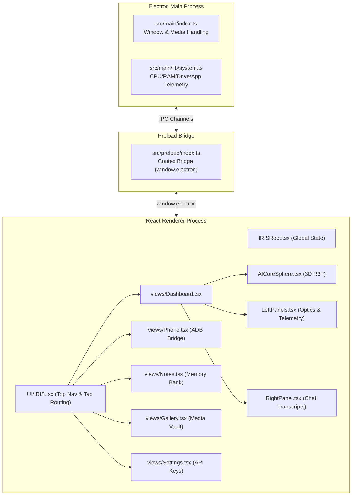

# 👁️ IRIS AI — Complete Codebase Scan & Architectural Inventory Report

**Scan Target:** `d:\App Winrar Files\AI Source Code\IRIS-AI-main`  
**Analyzed Repositories / Subsystems:** `IRIS-AI-main` (Core Application) & `PRIS` (Reverse-Engineering Specification Framework)  
**Project Type:** Voice-First Desktop Agentic Operating Layer (Electron + React + Vite + TypeScript)  
**Version:** `1.7.0`  
**License:** Custom / MIT Reference  

---

## 1. Executive Summary & Project Purpose

**IRIS AI** is an intelligent, voice-first desktop operating layer designed to sit natively on the desktop, monitor workflows, execute user intent, and bridge hardware/OS-level tasks with multimodal AI models (e.g., Google Gemini 2.5 Flash, Groq, Hugging Face, Tavily).

### Key Architectural Highlights
- **Desktop Runtime:** [Electron 30.5.1](file:///d:/App%20Winrar%20Files/AI%20Source%20Code/IRIS-AI-main/IRIS-AI-main/package.json#L51) with [electron-vite 5.0](file:///d:/App%20Winrar%20Files/AI%20Source%20Code/IRIS-AI-main/IRIS-AI-main/package.json#L54) bundling.
- **Frontend Architecture:** [React 18](file:///d:/App%20Winrar%20Files/AI%20Source%20Code/IRIS-AI-main/IRIS-AI-main/package.json#L60) + [TypeScript 5.3](file:///d:/App%20Winrar%20Files/AI%20Source%20Code/IRIS-AI-main/IRIS-AI-main/package.json#L63) + [Tailwind CSS 4](file:///d:/App%20Winrar%20Files/AI%20Source%20Code/IRIS-AI-main/IRIS-AI-main/package.json#L62) + [Framer Motion 12](file:///d:/App%20Winrar%20Files/AI%20Source%20Code/IRIS-AI-main/IRIS-AI-main/package.json#L31) + [GSAP 3.15](file:///d:/App%20Winrar%20Files/AI%20Source%20Code/IRIS-AI-main/IRIS-AI-main/package.json#L33).
- **3D Graphics:** [Three.js](file:///d:/App%20Winrar%20Files/AI%20Source%20Code/IRIS-AI-main/IRIS-AI-main/package.json#L40) with [@react-three/fiber](file:///d:/App%20Winrar%20Files/AI%20Source%20Code/IRIS-AI-main/IRIS-AI-main/package.json#L27) for the real-time responsive particle sphere (`AICoreSphere`).
- **Design System:** Cyberpunk / Glassmorphic dark aesthetic (`bg-zinc-950/40`, `backdrop-blur-xl`, emerald `#00ff88` accents, neon status indicators, frameless transparent window).

---

## 2. Directory Tree & Structural Mapping

```
IRIS-AI-main/
├── PRIS/                                   # Reverse-engineering framework & audit commands
│   ├── First Command.md                    # Initial user prompt trigger
│   ├── Second Command.md                   # Full audit bootstrap procedure
│   ├── PRIS_MASTER_REVERSE_ENGINEERING_COMMAND_v1.0.md # Detailed audit instructions
│   └── PRIS_TEMPLATE_v1.0.md               # Standard specification template
│
└── IRIS-AI-main/                           # Main Application Codebase
    ├── .editorconfig, .gitignore, .npmrc   # Tooling configurations
    ├── electron.vite.config.ts             # Vite config for Main, Preload & Renderer
    ├── electron-builder.yml                # Packaging & installer configuration
    ├── package.json                        # Dependencies, scripts & engine rules
    ├── tsconfig.json, tsconfig.node.json, tsconfig.web.json # TypeScript strict configs
    ├── eslint.config.mjs                   # ESLint configuration
    ├── Agents.md & CLAUDE.md               # System prompt & architectural rules
    ├── README.md & CHANGELOG.md            # Extensive documentation & version history
    │
    ├── bin/                                # Standalone CLI utilities
    │   └── iris-ai.ts                      # CLI boot sequence & simulation banner
    │
    ├── resources/                          # App Icons & Brand Assets
    │   ├── icon.png                        # Application icon (1.2 MB)
    │   └── logo.png                        # Main brand logo (2.7 MB)
    │
    ├── docs/                               # 24+ Detailed technical documentation markdown files
    │   ├── ARCHITECTURE.md, API_REFERENCE.md, VOICE_PROCESSING.md
    │   ├── IPC_BRIDGE.md, TOOLS_SYSTEM.md, SECURITY.md, etc.
    │   └── architecture/, core-systems/, development/, security/, troubleshooting/
    │
    ├── testing/                            # Modular test harnesses, mocks, & scaffolds
    │   ├── core/ (engine/, memory/, neural/)
    │   ├── plugins/ (auth/, render/)
    │   └── tests/ (e2e/, unit/)
    │
    └── src/                                # Core Application Source Code
        ├── main/                           # Electron Main Process (Node.js runtime)
        │   ├── index.ts                    # Main window creation, display media capture handler
        │   └── lib/
        │       └── system.ts               # Hardware metrics (CPU, RAM, Temp, Drives, StartApps)
        │
        ├── preload/                        # Electron Context Isolation Bridge
        │   ├── index.ts                    # Exposes safe IPC invoke/send to renderer window
        │   └── index.d.ts                  # TypeScript definitions for `window.electron`
        │
        └── renderer/                       # React / Web Frontend
            ├── index.html                  # HTML5 entrypoint
            └── src/
                ├── main.tsx                # React DOM root render
                ├── App.tsx                 # Root component wrapper
                ├── IRISRoot.tsx            # Frame layout, mic/call state, title bar integration
                ├── UI/
                │   └── IRIS.tsx            # Main shell, navigation bar, tab router
                ├── views/                  # Primary OS Modules
                │   ├── Dashboard.tsx       # Core HUD, AICore sphere, optics modal, panels
                │   ├── Phone.tsx           # Wireless Android ADB manager & screen streamer
                │   ├── Notes.tsx           # Memory bank markdown viewer & editor
                │   ├── Gallery.tsx         # Media vault for local photos & videos
                │   ├── Settings.tsx        # API Key management (Gemini, Groq, HF, Tavily)
                │   └── APP.tsx             # Application launcher
                ├── components/             # Reusable UI Elements
                │   ├── Titlebar.tsx        # Frameless window controls (Min/Max/Close, Mac/Win)
                │   └── UI/
                │       ├── AICoreSphere.tsx# 3D interactive particle sphere with lerped audio feedback
                │       ├── LeftPanels.tsx  # Vision feed monitor, hardware telemetry & network TX/RX
                │       └── RightPanel.tsx  # Live conversation transcript & streaming chat history
                └── services/
                    └── system-info.ts      # Renderer-side wrapper for system stats IPC calls
```

---

## 3. Subsystem Breakdown & Module Capabilities



### A. Dashboard & 3D Neural Core
- **File:** [Dashboard.tsx](file:///d:/App%20Winrar%20Files/AI%20Source%20Code/IRIS-AI-main/IRIS-AI-main/src/renderer/src/views/Dashboard.tsx) & [AICoreSphere.tsx](file:///d:/App%20Winrar%20Files/AI%20Source%20Code/IRIS-AI-main/IRIS-AI-main/src/renderer/src/components/UI/AICoreSphere.tsx)
- **Features:**
  - 3-column responsive grid layout: Left telemetry panels, Central AI Core with control dock, Right live transcript panel.
  - Three.js particle shell (900 particles with Fibonacci sphere distribution) and dual orbital rings.
  - Smooth animation lerping responsive to voice activity (`isSpeaking`) and connection state (`isConnected`).
  - Optics selector popup: toggles camera (`getUserMedia`) or screen share (`getDisplayMedia`).

### B. Vision Feed & System Telemetry
- **File:** [LeftPanels.tsx](file:///d:/App%20Winrar%20Files/AI%20Source%20Code/IRIS-AI-main/IRIS-AI-main/src/renderer/src/components/UI/LeftPanels.tsx) & [system.ts](file:///d:/App%20Winrar%20Files/AI%20Source%20Code/IRIS-AI-main/IRIS-AI-main/src/main/lib/system.ts)
- **Features:**
  - Live video playback with hidden canvas for periodic JPEG snapshot capture (60Hz tracking simulation).
  - Dynamic HSL color-coded health meters (`getHealthColor`) for CPU, RAM, and Temperature.
  - Real-time network telemetry (latency, simulated TX/RX traffic throughput, system uptime).
  - Simulated cyber boot sequence log terminal.

### C. Live Conversation Interface
- **File:** [RightPanel.tsx](file:///d:/App%20Winrar%20Files/AI%20Source%20Code/IRIS-AI-main/IRIS-AI-main/src/renderer/src/components/UI/RightPanel.tsx)
- **Features:**
  - Chat history renderer with user and model speech bubbles.
  - Real-time token streaming animation with animated green cursor.
  - Automatic scroll-to-bottom on new messages.

### D. Wireless Mobile Phone Bridge (ADB)
- **File:** [Phone.tsx](file:///d:/App%20Winrar%20Files/AI%20Source%20Code/IRIS-AI-main/IRIS-AI-main/src/renderer/src/views/Phone.tsx)
- **Features:**
  - Android ADB over TCP/IP (`adb tcpip 5555`).
  - Device memory archive and manual IP/port uplink form.
  - Step-by-step first-time setup guide with one-click command copying.
  - Live device screenshot stream rendering into virtual mobile frame.
  - Remote hardware quick-actions: Camera, Screen Wake, Lock, Home button.
  - Battery percentage, temperature, and storage utilization gauges.
  - Notification interceptor triggering synthetic speech events (`ai-force-speak`).

### E. Memory Bank (Notes Module)
- **File:** [Notes.tsx](file:///d:/App%20Winrar%20Files/AI%20Source%20Code/IRIS-AI-main/IRIS-AI-main/src/renderer/src/views/Notes.tsx)
- **Features:**
  - Markdown note viewer with GitHub Flavored Markdown (`remark-gfm`).
  - Interactive creator/editor with syntax styling.
  - Note list with auto-refresh and delete operations.

### F. Media Vault (Gallery Module)
- **File:** [Gallery.tsx](file:///d:/App%20Winrar%20Files/AI%20Source%20Code/IRIS-AI-main/IRIS-AI-main/src/renderer/src/views/Gallery.tsx)
- **Features:**
  - Media explorer for local screenshots, generated images, and video recordings.
  - Infinite scroll pagination using `IntersectionObserver`.
  - Full-screen lightbox modal with Framer Motion spring slide transitions and arrow-key navigation.
  - Actions: Open file location in OS Explorer/Finder, Export/Save copy, Delete.

### G. API Vault & Security Settings
- **File:** [Settings.tsx](file:///d:/App%20Winrar%20Files/AI%20Source%20Code/IRIS-AI-main/IRIS-AI-main/src/renderer/src/views/Settings.tsx)
- **Features:**
  - Encrypted local credential vault for Google Gemini, Groq Cloud, Hugging Face, and Tavily Search.

---

## 4. IPC Channel Inventory & Status

The following table lists the Inter-Process Communication (IPC) contracts in the codebase:

| IPC Channel | Direction | Status | Description |
|---|---|---|---|
| `get-system-stats` | Renderer $\rightarrow$ Main | Defined in [system.ts](file:///d:/App%20Winrar%20Files/AI%20Source%20Code/IRIS-AI-main/IRIS-AI-main/src/main/lib/system.ts#L121) | Fetches CPU load, RAM free/used, simulated temp, network & uptime |
| `get-installed-apps` | Renderer $\rightarrow$ Main | Defined in [system.ts](file:///d:/App%20Winrar%20Files/AI%20Source%20Code/IRIS-AI-main/IRIS-AI-main/src/main/lib/system.ts#L118) | Retrieves start menu apps (PowerShell / macOS `mdfind` / Linux `.desktop`) |
| `get-drives` | Renderer $\rightarrow$ Main | Defined in [system.ts](file:///d:/App%20Winrar%20Files/AI%20Source%20Code/IRIS-AI-main/IRIS-AI-main/src/main/lib/system.ts#L124) | Retrieves mounted disk drive partitions and free/total storage |
| `window-min` / `window-max` / `window-close` | Renderer $\rightarrow$ Main | Invoked in [Titlebar.tsx](file:///d:/App%20Winrar%20Files/AI%20Source%20Code/IRIS-AI-main/IRIS-AI-main/src/renderer/src/components/Titlebar.tsx#L23-L28) | Controls frameless window state |
| `get-notes` / `save-note` / `delete-note` | Renderer $\rightarrow$ Main | Invoked in [Notes.tsx](file:///d:/App%20Winrar%20Files/AI%20Source%20Code/IRIS-AI-main/IRIS-AI-main/src/renderer/src/views/Notes.tsx#L50-L113) | CRUD operations for memory bank markdown files |
| `get-gallery` / `delete-image` / `open-image-location` / `save-image-external` | Renderer $\rightarrow$ Main | Invoked in [Gallery.tsx](file:///d:/App%20Winrar%20Files/AI%20Source%20Code/IRIS-AI-main/IRIS-AI-main/src/renderer/src/views/Gallery.tsx#L52-L98) | Media file discovery, export, and deletion |
| `secure-get-keys` / `secure-save-keys` | Renderer $\rightarrow$ Main | Invoked in [Settings.tsx](file:///d:/App%20Winrar%20Files/AI%20Source%20Code/IRIS-AI-main/IRIS-AI-main/src/renderer/src/views/Settings.tsx#L45-L59) | Local encrypted storage for AI provider API tokens |
| `adb-connect` / `adb-disconnect` / `adb-telemetry` / `adb-screenshot` / `adb-quick-action` / `adb-get-notifications` / `adb-get-history` | Renderer $\rightarrow$ Main | Invoked in [Phone.tsx](file:///d:/App%20Winrar%20Files/AI%20Source%20Code/IRIS-AI-main/IRIS-AI-main/src/renderer/src/views/Phone.tsx#L45-L143) | Android Debug Bridge controls & screen streaming |

> [!NOTE]
> In [src/main/index.ts](file:///d:/App%20Winrar%20Files/AI%20Source%20Code/IRIS-AI-main/IRIS-AI-main/src/main/index.ts), `registerSystemHandlers(ipcMain)` needs to be imported and called on startup. If you plan to implement the storage/notes/gallery/ADB handlers on the Node side, they can be registered alongside `system.ts`.

---

## 5. Ready-to-Extend Opportunities & Next Steps

When adding new features to IRIS AI, the following extension points are already prepared in the architecture:
1. **Gemini Live Multimodal Voice Streaming:** Hooking the WebRTC / WebSocket bidirectional audio pipeline into `AICoreSphere` and `RightPanel`.
2. **Local Tool Execution:** Registering desktop automation tools (file manipulation, browser search, CLI commands, window management) in `src/main`.
3. **ADB Wireless Daemon Service:** Implementing the backend handlers in `src/main` using `adbkit` or system CLI `adb` commands.
4. **Persistent Memory Store:** Using `electron-store` or local file system storage for notes and configuration encryption.
5. **Additional Views / Tabs:** Easily expandable by appending entries to the `tabs` array in [IRIS.tsx](file:///d:/App%20Winrar%20Files/AI%20Source%20Code/IRIS-AI-main/IRIS-AI-main/src/renderer/src/UI/IRIS.tsx#L36-L42).

---
*Comprehensive project scan complete. The entire codebase is indexed and ready for your additions.*
